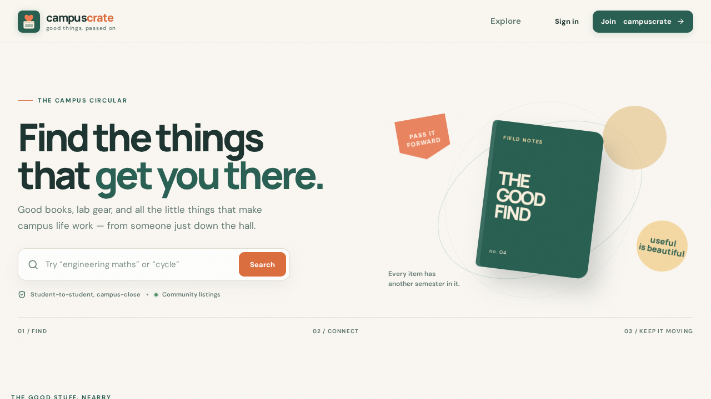

# Campus Crate

A trusted campus marketplace where college students can buy, sell and discover pre-loved items, electronics, notes and other campus essentials, instead of burying listings in WhatsApp groups.


**Live website:** https://campascrate.vercel.app/



---

## Table of Contents

- [About the Project](#about-the-project)
- [Features](#features)
- [Tech Stack](#tech-stack)
- [Project Structure](#project-structure)
- [Getting Started](#getting-started)
- [Environment Variables](#environment-variables)
- [Available Scripts](#available-scripts)
- [Deployment](#deployment)
- [Builders](#builders)
- [License](#license)

---

## About the Project

In most colleges, students sell and buy used books, lab coats, calculators, cycles and hostel items through WhatsApp groups. Listings get lost under new messages, there is no search or filter, and nobody knows which items are already sold.

Campus Crate moves this into one searchable place built for college students. Students can list items they no longer need and discover items posted by others on campus.

It was built for the SPIE Student Chapter at Acharya Narendra Dev College, University of Delhi.

## Features

- Buy, sell and rent pre-loved items, electronics, notes and essentials within a college community
- Search from the home page
- Sign up and sign in with Clerk authentication
- Responsive interface for phones, tablets and desktops

## Tech Stack

| Layer | Technology |
| --- | --- |
| Frontend | React, TypeScript, Vite |
| UI components | Radix UI primitives, Tailwind CSS |
| Authentication | Clerk |
| Hosting | Vercel |
| Package manager | npm or Bun (the repository includes `bun.lock`) |

## Project Structure

```
Campus-Crate/
  public/           Static assets
  src/              Application source code
  index.html        App entry HTML
  package.json      Dependencies and scripts
  bun.lock          Bun lockfile
  tsconfig.json     TypeScript configuration
  vite.config.ts    Vite configuration
  vercel.json       Vercel deployment configuration
  metadata.json     App metadata
  README.md
  LICENSE
```

## Getting Started

### Prerequisites

- [Node.js](https://nodejs.org) 18 or higher with npm, or [Bun](https://bun.sh)
- Git
- A free [Clerk](https://clerk.com) account for authentication

### 1. Clone the repository

```bash
git clone git@github.com:Sachin8147-star/Campus-Marketplace-web.git
cd Campus-Marketplace-web
```

### 2. Install dependencies

```bash
npm install
```

Or, with Bun:

```bash
bun install
```

### 3. Set up Clerk

1. Create an application in the Clerk dashboard.
2. Copy the **Publishable key** from the API keys page.
3. Add it to your `.env` file as shown in the next section.

### 4. Add environment variables

Create a `.env` file in the project root (see [Environment Variables](#environment-variables)).

### 5. Start the development server

```bash
npm run dev
```

Open the local URL printed in the terminal.

### 6. Build for production

```bash
npm run build
npm run preview
```

## Environment Variables

Create a `.env` file in the project root. Never commit it to Git.

| Variable | Description |
| --- | --- |
| `VITE_CLERK_PUBLISHABLE_KEY` | Clerk publishable key, from the Clerk dashboard |

Vite makes every variable that starts with `VITE_` visible in the browser. Only put public keys there, such as the Clerk publishable key. Private keys and secrets must never be placed in frontend code or in a `VITE_` variable.

## Available Scripts

| Command | What it does |
| --- | --- |
| `npm run dev` | Starts the development server |
| `npm run build` | Creates a production build |
| `npm run preview` | Serves the production build locally |

## Deployment

The app is deployed on Vercel at https://campascrate.vercel.app/. Deployment settings are in `vercel.json`. Add the same environment variables in the Vercel project settings under **Settings > Environment Variables**, then redeploy.

## Builders

- **Sachin**
- **Laxmi Narayan Verma**

[Sachin](https://github.com/Sachin8147-star)(https://www.linkedin.com/in/sachin8147-star/)
[Laxmi Narayan Verma](https://github.com/its-lnv)(https://www.linkedin.com/in/its-lnv/)


Built for the SPIE Student Chapter, Acharya Narendra Dev College, University of Delhi, New Delhi.

## License

This project is licensed under the MIT License. See the [LICENSE](LICENSE) file for details.
